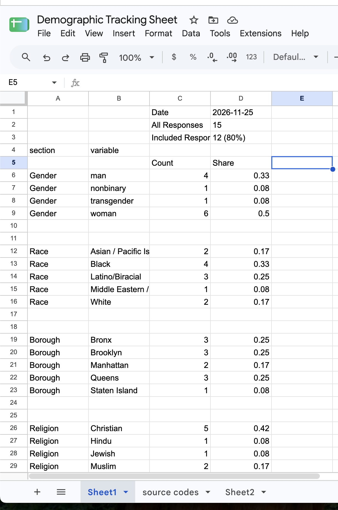
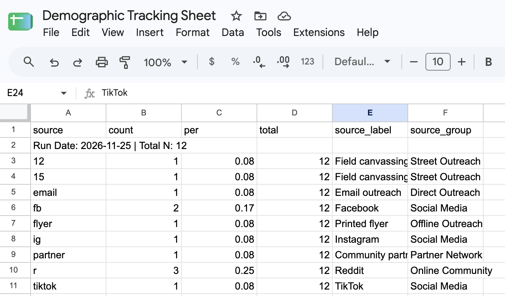

### Weekly Survey Reporting: R Automation

[View project on GitHub](https://github.com/zo-klo/Weekly-Report-Automation)

An R workflow that automates recurring survey reporting, replacing manual data transfer with a reproducible pipeline for demographic summaries and shareable reporting files.

The workflow processes cleaned survey outputs, calculates demographic summaries, groups and standardizes source codes, and generates reporting files. It can also append results directly to Google Sheets when configured.

**Tools:** R · tidyverse · YAML · googlesheets4 · googledrive

The public portfolio version preserves the automation logic while removing private IDs, organization-specific details, credentials, and machine-specific settings. Synthetic demo data lets the workflow run end-to-end without private organizational data.

#### Example output

Screenshots of the portfolio pipeline's synthetic demo output in Google Sheets.

**Demographic summaries and response counts**

[{: .img-responsive .img-centered}](/assets/automation-demographics.png)

**Standardized source codes**

[{: .img-responsive .img-centered}](/assets/automation-source-codes.png)
